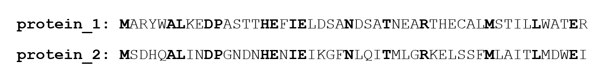
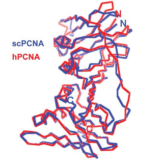

Percent, cent, century – there are many words in the language that share a root meaning “hundred”. Hundred itself is a round number, and as the square of 10, it fits my favourite visualization tool: [a square](https://excellentproblem.com/posts/2026-06-28-probability/). Percentages turn that hundred into a familiar scale that everyone understands - at least at a very basic level: 50% is half, 30% is less than half, 90% is a lot. Today I want to show you that these intuitions we all share might be locally correct but globally completely wrong.

## 50% and Vocabulary

Let’s start from the middle: 50%. Is 50% of something much? Well, my guess is that it is definitely not little. Here I discuss it in the context of a language’s vocabulary. Linguists have always been interested in word frequencies: how often a word is used in a language. In the past, they earned PhDs by extracting these numbers from a single book. It was tedious and not entirely straightforward work, actually (are “be” and “is” the same word? What about “read” verb and “read” noun? What about synonyms?). Nowadays, with modern computational linguistics tools and the availability of large text corpora, we have this information at our fingertips, for any language. This has led to the emergence of fascinating books: frequency dictionaries.

There was a month in my life when I was highly motivated to learn Spanish. I wanted to learn it quickly and efficiently, and discovering a book that listed all Spanish words by frequency seemed like the most useful tool I could find. This book was frequency dictionary – instead of arranging words alphabetically, it ranked them from the most often used. The preface offered fascinating facts, including this one: 100  English words[^1] constitutes 50% of all the words in the Oxford English Corpus. This estimate often applies to other Indo-European languages as well. Marvellous. The other side of the coin is that these are mostly function words: the, an, is, but, and, or, this, that, what, who – useful vocabulary in general, but useless for expressive purposes. These particular words will not empower you to communicate in 50% of situations. In fact, it will not empower you to communicate in even 5% of situations, perhaps with the exception of yes-or-no questions. My flawed shortcut was assuming that knowing a certain percentage of frequent words would let me communicate in the same percentage of situations. So now you know why I gave up on Spanish.  

## 30% and Proteins

Next value: 30%. This one is relevant not in the world of language but in the world of macromolecules: proteins, in particular. But we will make use of language anyway. Proteins are composed of 21 building blocks, amino acids, while English uses 26 letters. Therefore, you can think of proteins as long words written in a slightly shorter molecular alphabet. As if English was missing Z, J, O, B and U. The order of these 21 letters is known as the protein sequence. For example:

::: {fig-protein}

:::

As linguists care about word frequencies, structural biologists deeply care about accurately aligning the sequence of a protein of unknown structure with the sequence of a related protein of known structure. The resulting sequence alignment enables them to determine sequence identity between the two proteins. This is an example of what 30% sequence identity to protein_1 could look like:

::: {fig-comparison}

:::

If you rightly recognized the English sentence in the first line, I bet you cannot get the same message from the second line. The second line is not even English. 30% letter identity is not enough to conserve the message. In the world of protein structures, however, 30% sequence identity is often enough to conserve a message a protein has to pass on. A protein’s “message” is its function: enzymatic, structural, mechanical. So as little as 30% amino acids agreement between two related proteins is often enough for them both to, e.g., digest a molecule or contribute to a molecular scaffold in the cell. Important to mention, sequence comparison is relevant when talking about different species. When you compare X to Y. It is remarkable that when you choose a function fundamental to life as a basis of comparison, you can pick your X and Y very far apart. So let’s pick DNA replication[^2] as the process and human and yeast as our two species. A human protein PCNA that encircles the DNA prior replication starts, has 35% sequence identity with its yeast counterpart. Despite this, the two have virtually the same three-dimensional structure and fulfill the same function[^3].

::: {#fig1-pcna}

As proteins are linear molecules with side-chain appendages, their structure can be depicted by representing the main chain as an intricately twisted wire, while skipping the side chains completely. This let us see how similar the human (h) and the yeast (sc) PCNA are to each other.
:::

And back to the macroscopic world: 35% is roughly one in three. Next time you use these smelly fungi to make your dough rise, remember that part of the machinery that makes it rise is in shape and design the same machinery that turned a single fertilized egg into you. How could one not love biochemistry?

## 90% and Disease Testing

While you might be doubting whether 30% or 50% is much, when it comes to 90%, people usually have no such doubts. In terms of probability, everyone would like to take a bet with a 90% chance of winning. 90% is almost certain. However, sometimes you might take 90% as the answer to one question when it is actually answering another.

If you are being tested for a disease, you are most interested in whether you are sick or not. If you get a positive test result, along with a high test sensitivity value[^4], you tend to interpret it as proof of the disease. Nothing could be more wrong. Depending on how often the test turns positive for a healthy individual and how common the disease is in the population, the probability of being sick can be much lower than the test sensitivity. I have already devoted an entire post to this type of [probability puzzle](https://excellentproblem.com/posts/2026-06-28-probability/), and here I only point out that the reported 90% of test sensitivity is likely not the answer to the question you are really interested in.

∗ ∗ ∗

Even though percentages are pegged to unity, their value means nothing if stripped of context. Still, when something is expressed in %, we tend to assign it an evaluative category, like little, medium or much. In most of the cases, the question we should be asking instead is not whether it is much or little, but whether it is enough. Thank you for reading. 

[^1]: Dictionary words, i.e., unique dictionary instances – this e.g. collapses be/is/are/were/been/… into a single entry of “be”. [See](https://en.wikipedia.org/wiki/Most_common_words_in_English).

[^2]: DNA replication is the process by which a cell makes an exact copy of its DNA before it divides, so each new cell can get a complete set of genetic instructions.

[^3]: DeBiasio A et.al. (2011)Reduced Stability and Increased Dynamics in the Human Proliferating Cell Nuclear Antigen (PCNA) Relative to the Yeast Homolog. PLoSONE6(2):e16600 [doi](https://doi.org/10.1371/journal.pone.0016600)

[^4]: Test sensitivity is the percentage of sick people that the test correctly detects.